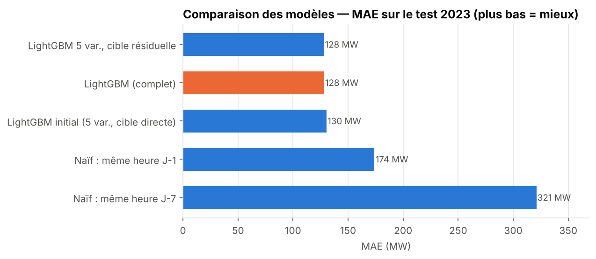
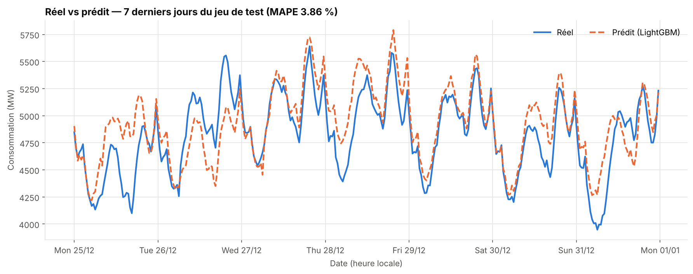
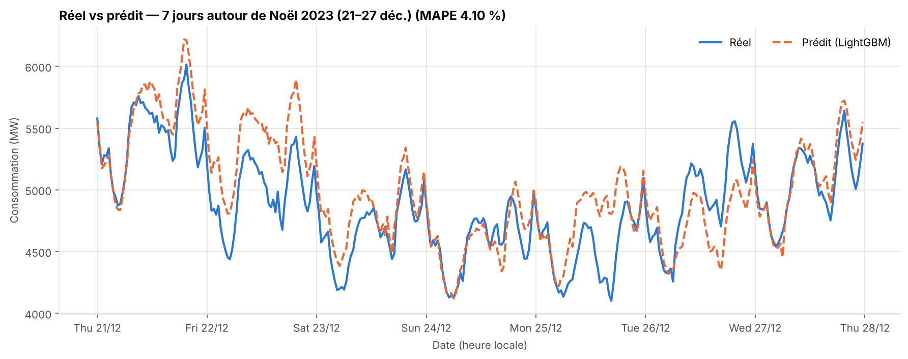
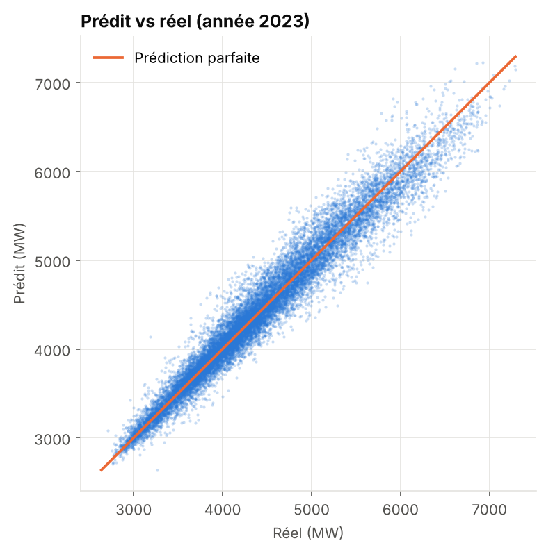
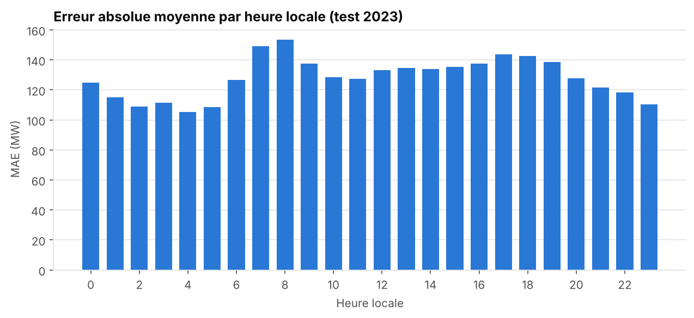
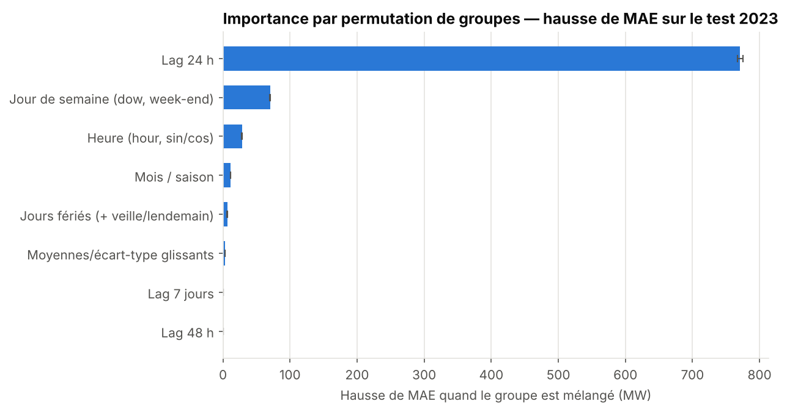
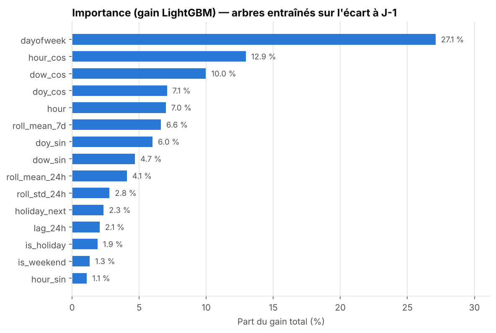

# Rapport : prévision de la consommation électrique régionale (PACA)

## 1. Objectif

Prévoir la consommation électrique de la région Provence-Alpes-Côte d'Azur au pas de 30 minutes avec LightGBM, à partir des données éCO2mix de RTE, puis analyser l'importance des variables et comparer valeurs réelles et prédites.

Cadre de prévision : pour prédire l'instant *t*, on n'utilise que des informations connues à *t − 24 h* ou avant. Tous les lags et statistiques glissantes sont décalés d'au moins 24 h. Les colonnes de production (nucléaire, solaire, thermique…) du fichier ne sont **pas** utilisées : elles ne sont pas connues à l'avance et divulgueraient de l'information sur la cible.

## 2. Données et nettoyage

| Élément | Valeur |
|---|---|
| Lignes brutes | 70 128 (une seule région : PACA) |
| Période | 01/01/2020 → 31/12/2023, pas de 30 min |
| Doublons d'horodatage supprimés | 8 (changements d'heure de printemps) |
| Trous après reconstruction de la grille | 8 pas, tous interpolés (interpolation temporelle, ≤ 4 pas) |
| Valeurs ≤ 0 | 0 |
| Grille finale | 70 128 pas réguliers |

Étapes (`src/data.py`) :

1. Conversion de `Date - Heure` en UTC : l'axe temporel devient strictement monotone malgré les décalages +01:00 / +02:00.
2. Suppression des doublons, reindexation sur une grille régulière de 30 minutes, interpolation des trous courts.
3. Les variables calendaires sont ensuite calculées en **heure locale** (Europe/Paris), car les habitudes de consommation suivent l'heure légale.

Le fichier fourni compte 70 128 lignes ; la mention « plus de 500 000 lignes » ne correspond pas à ces données (elle correspondrait à un export multi-régions, que le code sait traiter avec `--region ALL`).

## 3. Variables (`src/features.py`)

| Famille | Variables |
|---|---|
| Calendrier | heure (fractionnaire), jour de semaine, mois, week-end |
| Jours fériés (France) | jour férié, veille de férié, lendemain de férié |
| Cycliques | sin/cos de l'heure (24 h), du jour de semaine (7 j), du mois (12), du jour de l'année (365,25) |
| Lags | consommation à t − 24 h, t − 48 h, t − 7 j |
| Fenêtres glissantes (sur le passé ≥ 24 h) | moyenne et écart-type sur 24 h, moyenne sur 7 j |

Les encodages sinus/cosinus rapprochent 23h30 et 00h00, ce qu'un entier `hour` ne permet pas. Les tests (`tests/test_pipeline.py`) vérifient l'absence de fuite : `lag_24h(t)` vaut exactement la consommation à t − 24 h, et les moyennes glissantes ne voient jamais la journée courante.

## 4. Modèle et protocole

- **Découpage temporel strict** (heure locale) : entraînement 08/01/2020 → 30/09/2022 (47 807 pas), validation 01/10/2022 → 31/12/2022 (4 418 pas), **test : année 2023 entière** (17 520 pas).
- **LightGBM** : taux d'apprentissage 0,03, 31 feuilles, `min_child_samples=50`, sous-échantillonnage 80 % des lignes et des colonnes, arrêt anticipé sur la MAE de validation (patience 100), puis ré-entraînement sur entraînement + validation avec le nombre d'itérations retenu (+10 %).
- **Cible résiduelle** : le modèle apprend l'écart `conso(t) − conso(t − 24 h)` ; la prédiction est `lag_24h + écart prédit`. Ce choix a été fait sur la **validation** (MAE 151 MW contre 162 MW pour la cible directe), pas sur le test. Les arbres, constants par morceaux, extrapolent mal un niveau absolu qui dérive (sobriété énergétique 2022–2023).
- **Baselines** : même heure la veille (J-1) et même heure la semaine précédente (J-7).

## 5. Résultats

| Modèle | MAE (MW) | RMSE (MW) | MAPE (%) | R² |
|---|---:|---:|---:|---:|
| Naïf : même heure J-7 | 321,0 | 438,2 | 6,91 | 0,713 |
| Naïf : même heure J-1 | 173,9 | 237,7 | 3,91 | 0,916 |
| LightGBM initial (5 var., cible directe) | 130,3 | 178,3 | 2,91 | 0,953 |
| LightGBM 5 var., cible résiduelle | 128,0 | 175,7 | 2,85 | 0,954 |
| **LightGBM complet (cible résiduelle)** | **128,1** | **175,5** | **2,85** | **0,954** |

**Ce que montre l'ablation.**

- Le modèle LightGBM réduit la MAE de 26 % par rapport à la baseline J-1 (173,9 → 128,1 MW).
- La cible résiduelle apporte un gain faible mais cohérent (130,3 → 128,0 MW sur les 5 variables initiales).
- Les variables supplémentaires (cycliques, lags 48 h/7 j, fenêtres glissantes) **n'apportent pas de gain mesurable sur le test 2023** (128,1 vs 128,0 MW). Sur la validation (T4 2022) elles semblaient aider davantage, ce qui rappelle qu'un seul découpage reste fragile. Elles restent utiles pour l'interprétation, mais ce n'est pas un gain de performance démontré ici.

### Réel vs prédit

Les 7 derniers jours du test (25 déc. → 1ᵉʳ janv.) forment une période difficile : fêtes de fin d'année, consommation atypique. Le modèle suit bien les cycles journaliers mais commet de gros écarts les jours atypiques : surestimation le 25 décembre et le 31, sous-estimation le 27. Une explication plausible (non vérifiée) est que la veille, qui sert d'ancre à la prédiction, n'est pas représentative les jours de fête.

### Erreurs par segment (test 2023)

| Segment | MAE (MW) | MAPE (%) | Pas |
|---|---:|---:|---:|
| Jours ouvrés normaux | 127,7 | 2,78 | 12 048 |
| Week-ends | 128,8 | 2,98 | 5 040 |
| Jours fériés | 149,6 | 3,84 | 528 |
| Noël (25–26 déc. 2023) | 255,6 | 5,44 | 96 |

Par mois : la MAE va de 60 MW (octobre) à 202 MW (décembre), avec février à 187 MW et janvier à 182 MW. Par heure : de 105 MW (4 h) à 154 MW (8 h, montée du matin). Les mois d'hiver sont les plus difficiles ; la température, absente des variables, est une explication plausible mais non testée ici.

## 6. Importance des variables

Mesure de référence : importance par **permutation de groupes** sur le test (les variables corrélées, par exemple `hour`, `hour_sin`, `hour_cos`, sont mélangées ensemble ; 5 répétitions). Hausse de MAE quand le groupe est détruit :

| Groupe | Hausse de MAE (MW) |
|---|---:|
| Lag 24 h | 771,2 |
| Jour de semaine (dow, week-end) | 70,3 |
| Heure | 28,5 |
| Mois / saison | 11,4 |
| Jours fériés (+ veille/lendemain) | 6,4 |
| Moyennes / écart-type glissants | 3,0 |
| Lag 7 jours | 0,6 |
| Lag 48 h | 0,2 |

Le lag 24 h est de loin le plus informatif : la consommation d'hier à la même heure est le meilleur prédicteur. Viennent ensuite le jour de semaine puis l'heure, qui corrigent l'écart entre « hier » et « aujourd'hui » (par exemple lundi après un dimanche). Les lags 48 h et 7 j sont presque redondants avec le lag 24 h, ce qui explique l'absence de gain de l'ablation.

Attention à la lecture du **gain** : les arbres sont entraînés sur l'écart à J-1, donc le gain mesure ce qui explique la *déviation* par rapport à la veille (jour de semaine 27 %, heure et jour de semaine cycliques en tête), pas le niveau. Le lag 24 h n'y pèse que 2 % alors qu'il est le plus important ; c'est un effet de l'ancrage, pas un défaut. La figure du script initial (`conso_hier` à 97 % du gain) reflétait au contraire un modèle à cible directe.

## 7. Corrections apportées au script initial

1. Heure et jours fériés calculés en UTC → heure locale.
2. `shift(48)` sur une série irrégulière (doublons, trous dus aux changements d'heure) → grille régulière.
3. Commentaire « 96 pas de 15 min » incohérent avec le code (48 pas de 30 min).
4. Test limité à 30 jours, et métrique « 25–26 déc. 2020 » jamais calculable → test 2023 entier, Noël 2023 évalué.
5. Ajout d'une validation avec arrêt anticipé, de baselines et d'une ablation.
6. Encodages cycliques ajoutés ; `is_holiday` désormais pris en compte dans l'analyse d'importance.
7. Graphique « première semaine » : titre et axe corrigés.
8. Importance normalisée en pourcentages, complétée par la permutation de groupes.

## 8. Limites

- Pas de température ni d'autres données exogènes.
- Une région, quatre années, dont deux atypiques (2020 Covid, 2022–2023 sobriété).
- Un seul découpage temporel : un test 2023 unique ne mesure pas la variabilité inter-années.
- Hyperparamètres non optimisés ; pas d'intervalles de prédiction.

## 9. Pistes

1. Ajouter la température observée/prévue (Météo-France) : forte amélioration attendue en hiver.
2. Validation croisée en fenêtre glissante (`expanding window`) pour des intervalles de confiance sur les métriques.
3. Régression quantile LightGBM pour des intervalles de prévision.
4. Extension à toutes les régions (`--region ALL`) et comparaison inter-régionale.
5. Variables « vacances scolaires » et ponts.

## 10. Reproductibilité

`python src/run_pipeline.py` régénère `results/` (métriques, importances, prédictions du test, `summary.json`, journal) et `figures/`. Graine fixée à 42. Versions testées : Python 3.13, pandas 3.0, LightGBM 4.7, holidays 0.107.
